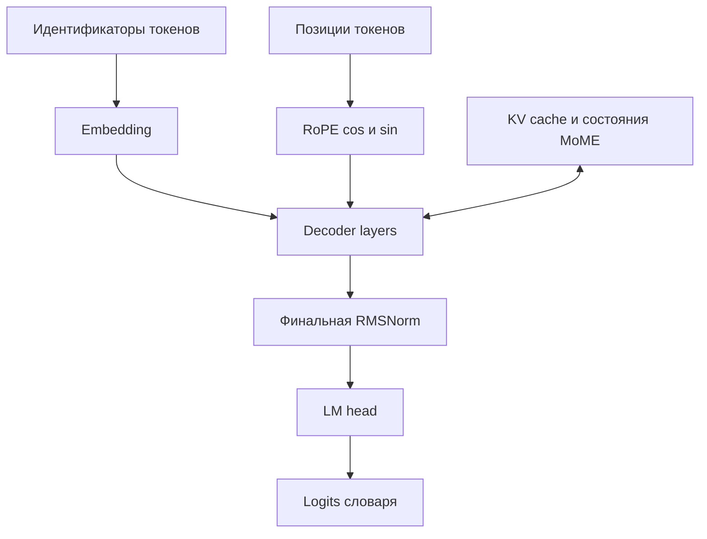

# Pangu 505B архитектура и реализация в OmniInfer

Все команды ниже выполняются из корня `vllm-bench` после настройки:

```bash
export PYTHONPATH="$PWD/src${PYTHONPATH:+:$PYTHONPATH}"
```

Pangu 505B из предоставленного [config-hf.json](../../conf/common/reference_config-hf.json) — авторегрессионная языковая модель с 50 основными слоями, MLA attention, 384 routed experts в каждом MoE-слое и 8 выбираемыми экспертами на токен. Конфиг задаёт архитектуру `OpenPanguV2ForCausalLM`, BF16, MoME, четыре residual streams mHC и три MTP-слоя. Именно этот вариант является основным предметом описания; отличия от ранее рассмотренного Ultra-пути отмечены как следствия предоставленного конфига.

Описание относится к локальному снимку OmniInfer `4cd855b29b5eb0a78bca645fad39e3181c35d099` от 16 октября 2026 года. Ссылки на реализацию ведут в репозиторий Gitee `huting233/omniinfer` на указанный коммит; номера строк заданы якорями `#L`. Для открытия исходников нужен доступ к этому репозиторию. Копия предоставленного `config-hf.json` сохранена рядом как `conf/common/reference_config-hf.json`. Название Python-пакета в импортах — `omni_npu`, каталог исходников в репозитории — `omni`.

## Имена модели и выбор реализации

В репозитории существуют две записи для текстовой 505B с одинаковыми основными размерностями, но разными классами исполнения:

| Идентификатор конфигурации | Поле `architectures` | Основной файл реализации |
| --- | --- | --- |
| `pangu_v2_moe_505B` | `OpenPanguV2ForCausalLM` | `omni/v1/models/pangu/pangu_v2_moe.py` |
| `openpangu_v2_505B` | `PanguUltraMoEForCausalLM` | `omni/v1/models/pangu/pangu_ultra_moe.py` |

В обоих случаях `model_type` равен `openpangu_v2`. Поэтому одного `model_type` недостаточно для определения используемого кода: имеет значение поле `architectures`, включая применённые HF overrides. Сопоставление размерностей и архитектуры с внутренним именем выполняется в `_match_model_name`.

Источники: [таблица моделей](https://gitee.com/huting233/omniinfer/blob/4cd855b29b5eb0a78bca645fad39e3181c35d099/omni/model_config/configs/match_hf_configs.json#L254), [сопоставление HF config](https://gitee.com/huting233/omniinfer/blob/4cd855b29b5eb0a78bca645fad39e3181c35d099/omni/model_config/config_loader/loader.py#L289), [регистрация классов в vLLM](https://gitee.com/huting233/omniinfer/blob/4cd855b29b5eb0a78bca645fad39e3181c35d099/omni/v1/models/__init__.py#L5).

**Расхождение из-за конфига:** в `config-hf.json` указано `architectures=["OpenPanguV2ForCausalLM"]`. Вместе с остальными признаками этот JSON соответствует записи `pangu_v2_moe_505B`, а не `openpangu_v2_505B`. Поэтому основной класс здесь — `OpenPanguV2ForCausalLM` из `pangu_v2_moe.py`. Последние изменения Ultra/A5/MXFP8 описаны отдельно; их нельзя автоматически приписывать этому JSON.

Внутри V2 есть ещё один выбор: по умолчанию используется `NPUPanguSparseAttention`; переменная `OMNI_PANGU_V2_HIGH_THROUGHOUT=1` переключает attention на `NPUDeepseekSparseAttention` и `NPUDeepseekMLAAttention`, сохраняя V2-класс модели. Значение этой переменной по умолчанию — false. Сам HF JSON переменную не задаёт. Переход к Ultra требует отдельного изменения `architectures`, например HF override, и не следует из одного выбора режима high throughput.

Источники: [architectures в конфиге](../../conf/common/reference_config-hf.json#L2), [выбор attention V2](https://gitee.com/huting233/omniinfer/blob/4cd855b29b5eb0a78bca645fad39e3181c35d099/omni/v1/models/pangu/pangu_v2_moe.py#L1497), [значение переменной по умолчанию](https://gitee.com/huting233/omniinfer/blob/4cd855b29b5eb0a78bca645fad39e3181c35d099/omni/envs.py#L381).

Отдельные записи `openpangu_v2_vl_505B` описывают мультимодальные модели. Этот JSON задаёт текстовую модель и не содержит параметров визуального энкодера.

## Размерности и параметры checkpoint

Значения ниже взяты из [предоставленного конфига](../../conf/common/reference_config-hf.json). Нумерация слоёв начинается с нуля.

| Параметр | Значение | Следствие |
| --- | --- | --- |
| `num_hidden_layers` | 50 | Основные decoder layers имеют индексы 0–49 |
| `first_k_dense_replace` | 3 | FFN слоёв 0–2 плотные, FFN слоёв 3–49 используют MoE; всего 47 основных MoE-слоёв |
| `hidden_size` | 5120 | Размер представления токена внутри attention и FFN |
| `num_attention_heads` | 64 | Число основных attention heads |
| `vocab_size` | 151552 | Логический размер словаря |
| `intermediate_size` | 16128 | Ширина плотного FFN |
| `n_routed_experts` | 384 | Число routed experts в каждом MoE-слое |
| `num_experts_per_tok` | 8 | Число выбираемых routed experts на токен в MoE-слое |
| `n_shared_experts` | 1 | Один общий эксперт добавляет свой вклад |
| `moe_intermediate_size` | 1792 | Ширина каждого routed expert и общего эксперта |
| `hidden_act` | `silu` | В gated FFN используется SwiGLU |
| `dtype` | `bfloat16` | Заявленная точность модели — BF16 |
| `num_nextn_predict_layers` | 3 | Дополнительные MTP-слои 50, 51, 52 |
| `max_position_embeddings` | 524288 | Верхняя граница позиций, объявленная конфигом |
| `use_cache` | true | Кеширование разрешено на уровне HF config |

Основные размерности совпадают с [записью pangu_v2_moe_505B](https://gitee.com/huting233/omniinfer/blob/4cd855b29b5eb0a78bca645fad39e3181c35d099/omni/model_config/configs/match_hf_configs.json#L254). Количество MoE-слоёв следует из условия выбора FFN в [OpenPanguV2DecoderLayer](https://gitee.com/huting233/omniinfer/blob/4cd855b29b5eb0a78bca645fad39e3181c35d099/omni/v1/models/pangu/pangu_v2_moe.py#L1640).

**Уточнение из-за конфига:** ранее глубина, top-k экспертов и контекст были оставлены зависимыми от checkpoint. Для этого JSON они известны: 50 слоёв, 8 routed experts и 524288 позиций, то есть 512 Ki позиций. Это объявленный предел конфигурации; фактический `max_model_len` сервера и доступная память могут ограничивать запросы сильнее. Значение 8192 в общем конструкторе здесь не применяется, поскольку поле явно задано.

### Позиции и специальные токены

| Поле | Значение |
| --- | --- |
| `rope_theta` | 6400000 |
| `rope_interleave` | false |
| `bos_token_id` | 148899 |
| `eos_token_id` и `pad_token_id` | Оба 148902 |
| `tie_word_embeddings` | false |
| `attention_dropout` | 0.0 |
| `_attn_implementation` | `eager` |
| `transformers_version` | `5.0.0` |
| `auto_map.AutoConfig` | `configuration_openpangu_v2.OpenPanguV2Config` |

Embedding и LM head у этого варианта не связаны по условию `tie_word_embeddings`. Совпадение EOS и PAD — явная настройка JSON. Поле `_attn_implementation="eager"` относится к HF-конфигурации и само по себе не отключает NPU kernels или графы OmniInfer. `transformers_version` описывает метаданные конфига и не доказывает установленную на машине версию.

В JSON нет готового словаря `rope_parameters`, `rope_scaling` и коэффициента расширения контекста. V2 вызывает нормализацию параметров после создания HF config; точный результат зависит и от `OpenPanguV2Config`, указанного в `auto_map`. Поэтому из `max_position_embeddings=524288` нельзя вывести дополнительный коэффициент YaRN. Функция нормализации меняет `rope_type="default"` на `deepseek_yarn` с defaults, только если `rope_parameters` уже существует как словарь.

Источники: [поля позиций и токенов](../../conf/common/reference_config-hf.json#L21), [подготовка RoPE в V2](https://gitee.com/huting233/omniinfer/blob/4cd855b29b5eb0a78bca645fad39e3181c35d099/omni/v1/models/pangu/pangu_v2_moe.py#L1568), [нормализация RoPE](https://gitee.com/huting233/omniinfer/blob/4cd855b29b5eb0a78bca645fad39e3181c35d099/omni/v1/models/pangu/utils.py#L477), [создание LM head](https://gitee.com/huting233/omniinfer/blob/4cd855b29b5eb0a78bca645fad39e3181c35d099/omni/v1/models/pangu/pangu_v2_moe.py#L2559).

### Отличия от ранее рассмотренного варианта

| Тема | Что следует именно из config-hf.json |
| --- | --- |
| Архитектура | V2, а не Ultra; меняются классы модели, mHC, MoME и MTP |
| Точность | BF16; `quantization_config` отсутствует, MXFP8 этим JSON не включён |
| Разреженный attention | 18 основных DSA-слоёв, 32 основных SWA-слоя |
| Общий indexer | Поля включения sharing отсутствуют; без добавленных defaults или overrides DSA-слои вычисляют свои индексы |
| CLA | `cla_explicit_mapping` отсутствует; повторное использование CLA конфигом не задано |
| Контекст | Явно 524288 позиций вместо использования default 8192 |
| mHC | Включён, 4 потока, 20 итераций нормализации |
| MoME | Включён, окно причинной свёртки 3 |
| MTP | 3 обучаемых predictor layers; это не значение speculative tokens сервера |

Отсутствие поля в исходном JSON не исключает его добавления классом HF config или внешними overrides. Все выводы «не включён» относятся к предоставленному файлу без таких дополнений. Обозначение 505B остаётся именем модели: точное число сохранённых параметров требует также состава checkpoint и правил учёта MTP и общих весов.

## Общая схема вычислений

Модель получает `input_ids` либо готовые `inputs_embeds`, вычисляет скрытые состояния и отдельно преобразует их в logits словаря. Генерация следующего токена использует эти logits; сам `forward` основного класса не выполняет весь цикл генерации.



`OpenPanguV2Model` создаёт embedding, 50 decoder layers, модуль сведения mHC и финальную RMSNorm. `OpenPanguV2ForCausalLM` добавляет `NPUParallelLMHead` и `NPULogitsProcessor`. В этом конфиге `tie_word_embeddings=false`, поэтому выходная проекция не привязывается к embedding. При pipeline parallelism embedding создаётся на первой стадии, финальная нормализация и LM head — на последней; промежуточные стадии передают скрытые состояния и residual.

Источники: [OpenPanguV2Model](https://gitee.com/huting233/omniinfer/blob/4cd855b29b5eb0a78bca645fad39e3181c35d099/omni/v1/models/pangu/pangu_v2_moe.py#L2306), [вычисление модели](https://gitee.com/huting233/omniinfer/blob/4cd855b29b5eb0a78bca645fad39e3181c35d099/omni/v1/models/pangu/pangu_v2_moe.py#L2409), [LM head](https://gitee.com/huting233/omniinfer/blob/4cd855b29b5eb0a78bca645fad39e3181c35d099/omni/v1/models/pangu/pangu_v2_moe.py#L2559).

### Устройство decoder layer

Один слой содержит attention и FFN. Из-за `first_k_dense_replace=3` в этом конфиге слои 0–2 используют `OpenPanguV2MLP`, а 3–49 — `OpenPanguV2MOE`. Выбор типа FFN независим от типа attention: например, слой 0 сочетает DSA с плотным FFN.

В этом конфиге включены `sandwich_norm=true` и mHC. Основная схема блока: mHC pre → input RMSNorm → attention → post-attention RMSNorm → mHC post; затем mHC pre → pre-MLP RMSNorm → FFN → post-MLP RMSNorm → mHC post. На указанных в конфиге слоях добавляется block post RMSNorm. Реализация V2 также содержит слитые варианты этой последовательности.

Источники: [OpenPanguV2DecoderLayer](https://gitee.com/huting233/omniinfer/blob/4cd855b29b5eb0a78bca645fad39e3181c35d099/omni/v1/models/pangu/pangu_v2_moe.py#L1530), [наглядная последовательность блока](https://gitee.com/huting233/omniinfer/blob/4cd855b29b5eb0a78bca645fad39e3181c35d099/omni/v1/models/pangu/pangu_v2_moe.py#L2121).

## Attention и представление KV

### Размерности MLA

В этом конфиге `q_lora_rank=1536`, `kv_lora_rank=512`, `qk_nope_head_dim=128`, `qk_rope_head_dim=64`, `v_head_dim=128`. Основных голов 64. До absorb размер Q/K одной головы равен 192: 128 каналов без позиционного вращения и 64 с RoPE. Размер value одной головы — 128, суммарный размер выхода голов до `o_proj` — 8192.

Q проходит через `q_a_proj`, RMSNorm и повышающую проекцию. KV формируется через `kv_a_proj_with_mqa` со сжатой частью 512 и RoPE-частью 64. В absorb-пути используются производные матрицы `W_UK_T` и `W_UV`, чтобы attention работал со сжатым KV. Это отличается от хранения полного K и V для каждой из 64 голов.

Источники: [размерности в конфиге](../../conf/common/reference_config-hf.json#L20), [MLA-веса V2 attention](https://gitee.com/huting233/omniinfer/blob/4cd855b29b5eb0a78bca645fad39e3181c35d099/omni/v1/layers/attention/npu_pangu.py#L915), [общий MLA absorb](https://gitee.com/huting233/omniinfer/blob/4cd855b29b5eb0a78bca645fad39e3181c35d099/omni/v1/layers/attention/npu_mla.py#L188).

### Распределение DSA и SWA

**Уточнение из-за конфига:** основной стек состоит из 18 DSA и 32 SWA-слоёв. Все индексы 0–49 покрыты, пересечений между группами нет.

| Тип | Индексы | Параметры |
| --- | --- | --- |
| DSA | 0, 3, 6, 9, 12, 15, 18, 21, 24, 27, 30, 33, 36, 39, 42, 45, 48, 49 | `index_topk=2048` |
| SWA основного стека | 1, 2, 4, 5, 7, 8, 10, 11, 13, 14, 16, 17, 19, 20, 22, 23, 25, 26, 28, 29, 31, 32, 34, 35, 37, 38, 40, 41, 43, 44, 46, 47 | Окно 512 |
| SWA MTP | 50, 51, 52 | Окно 2048 |

Вплоть до слоя 47 повторяется группа DSA → SWA → SWA; слои 48 и 49 оба DSA. Пары `swa_layers` и `sliding_window_list` сопоставляются по позиции: первые 32 записи задают окно 512, последние три — 2048 для MTP. Индексы 50–52 в `swa_layers` согласованы с тремя дополнительными predictor layers и не означают наличие 53 основных слоёв. Скаляром `sliding_window=512` нельзя заменять весь список: именно из-за этого конфига окна MTP больше.

По умолчанию V2 создаёт единый класс `NPUPanguSparseAttention`, который определяет SWA по `swa_layers`, MTP по индексу и DSA для оставшихся слоёв при положительном `index_topk`. С переключателем `OMNI_PANGU_V2_HIGH_THROUGHOUT=1` DSA выбирается по `dsa_layers`, а остальным слоям назначается MLA с локальным окном. Для данного JSON обе классификации совпадают.

Источники: [dsa_layers](../../conf/common/reference_config-hf.json#L10), [окна SWA](../../conf/common/reference_config-hf.json#L46), [классификация V2 attention](https://gitee.com/huting233/omniinfer/blob/4cd855b29b5eb0a78bca645fad39e3181c35d099/omni/v1/layers/attention/npu_pangu.py#L720), [выбор high throughput backend](https://gitee.com/huting233/omniinfer/blob/4cd855b29b5eb0a78bca645fad39e3181c35d099/omni/v1/models/pangu/pangu_v2_moe.py#L1501), [окна MLA](https://gitee.com/huting233/omniinfer/blob/4cd855b29b5eb0a78bca645fad39e3181c35d099/omni/v1/layers/attention/npu_mla.py#L760).

### Indexer и выбор позиций контекста

DSA indexer выбирает позиции контекста для разреженного attention. Здесь у indexer 32 головы по 128 каналов, `index_topk=2048`. Это отдельные величины от 64 голов основного attention и top-8 экспертов MoE. Число 2048 задаёт бюджет выбранных позиций для DSA и не ограничивает весь контекст до 2048 токенов.

В стандартном V2-пути используется `NPUPanguIndexer`; в альтернативном DSA-пути — `Indexer` из `npu_dsa.py`. Оба содержат проекции Q, K и весов indexer; Pangu-ветка нормализует K через RMSNorm. Комментарий с примером 64 indexer heads в общем `Indexer` не относится к данному JSON: **именно конфиг задаёт 32**.

Источники: [параметры indexer](../../conf/common/reference_config-hf.json#L16), [NPUPanguIndexer](https://gitee.com/huting233/omniinfer/blob/4cd855b29b5eb0a78bca645fad39e3181c35d099/omni/v1/layers/attention/npu_pangu.py#L197), [общий Indexer](https://gitee.com/huting233/omniinfer/blob/4cd855b29b5eb0a78bca645fad39e3181c35d099/omni/v1/layers/attention/npu_dsa.py#L131).

### Общий indexer и CLA

**Расхождение из-за конфига:** в JSON нет `indexer_types`, `index_topk_pattern`, `index_topk_freq` и `index_skip_topk_offset`. В стандартном V2-пути отсутствие `indexer_types` даёт `skip_topk=false`. В альтернативном DSA-пути частота по умолчанию равна 1, что также не пропускает вычисление top-k. Следовательно, предоставленный файл не включает общий indexer: каждый из 18 DSA-слоёв вычисляет собственный выбор позиций, если HF config или overrides не добавят соответствующие поля.

Поддержка общего indexer в последних коммитах остаётся возможностью реализации. Правила разных backend различаются: стандартный V2 проверяет `indexer_types`, общий DSA дополнительно понимает pattern и frequency. Наличие поддержки не означает её активации данным JSON. В Ultra-пути выбранные индексы передаются через `topk_indices_buffer`; этот интерфейс нельзя безусловно переносить на V2.

Аналогично, `cla_explicit_mapping` отсутствует. Функция `get_cla_mapping` без него возвращает пустое отображение; повторное использование KV через CLA конфигом не задано.

Источники: [правило sharing V2](https://gitee.com/huting233/omniinfer/blob/4cd855b29b5eb0a78bca645fad39e3181c35d099/omni/v1/layers/attention/npu_pangu.py#L4782), [правила общего DSA](https://gitee.com/huting233/omniinfer/blob/4cd855b29b5eb0a78bca645fad39e3181c35d099/omni/v1/layers/attention/npu_dsa.py#L88), [CLA mapping](https://gitee.com/huting233/omniinfer/blob/4cd855b29b5eb0a78bca645fad39e3181c35d099/omni/v1/layers/utils.py#L40).

### Обучаемые sinks

`param_sink_number=128` включает параметризованные sink-представления. В стандартном V2 attention создаются `param_sink_compressed_kv` размером `[128, 512]` и `param_sink_k_pe` размером `[128, 64]`. Это обучаемые параметры attention; они не означают сохранение первых 128 токенов запроса без преобразования. В конфиге не указан `use_gpt_oss_sink`, поэтому отдельный GPT-OSS sink-механизм этим файлом не включён.

Источники: [число sinks](../../conf/common/reference_config-hf.json#L35), [создание sink-параметров](https://gitee.com/huting233/omniinfer/blob/4cd855b29b5eb0a78bca645fad39e3181c35d099/omni/v1/layers/attention/npu_pangu.py#L1114).

## MoE и вычисление экспертов

### Плотный FFN и эксперт

`OpenPanguV2MLP` объединяет `gate_proj` и `up_proj` в `gate_up_proj`, применяет `SiluAndMul` и затем `down_proj`. Для этого конфига `hidden_act="silu"`. Концептуально это SwiGLU:

```text
FFN(x) = down_proj(SiLU(gate_proj(x)) * up_proj(x))
```

У плотного FFN промежуточная размерность равна 16128. У одного routed expert — 1792. Общие эксперты реализованы отдельным MLP с размерностью `moe_intermediate_size * n_shared_experts`, то есть 1792 для данной записи модели.

Источники: [OpenPanguV2MLP](https://gitee.com/huting233/omniinfer/blob/4cd855b29b5eb0a78bca645fad39e3181c35d099/omni/v1/models/pangu/pangu_v2_moe.py#L164), [создание shared expert V2](https://gitee.com/huting233/omniinfer/blob/4cd855b29b5eb0a78bca645fad39e3181c35d099/omni/v1/models/pangu/pangu_v2_moe.py#L299).

### Маршрутизация токена

Маршрутизатор V2 — неквантованная `ReplicatedLinear` без линейного bias с выходом на 384 эксперта. Его веса создаются в FP32; дополнительный `e_score_correction_bias` также FP32. В конфиге `router_enable_expert_bias=true`, `norm_topk_prob=true`, `num_experts_per_tok=8` и `routed_scaling_factor=2.5`. Для экспертов задан `scoring_func="sigmoid"`. Correction bias для выбора экспертов отличается от bias обычного линейного слоя.

В конфиге запрошено `norm_topk_prob=true`; это значение передаётся в MoE runner. При этом специализированные V2-ветки AllGather и dispatch/combine вызывают `npu_moe_gating_top_k` с `norm_type=1`, `renorm=0` и `routed_scaling_factor=2.5`. Интерпретация флагов относится к контракту NPU-оператора; одного значения HF config недостаточно, чтобы приписать всем backend одинаковую последовательность нормализации. Явная sigmoid/top-k реализация strong consistency находится в общем runner и относится к использующим его веткам. Это различие реализации и заявленного поля конфига, а не другое значение в самом JSON.

В каждом из 47 основных MoE-слоёв токен направляется к 8 из 384 routed experts и получает вклад одного shared expert. Это 8/384, или около 2,08% routed experts данного слоя. Эта доля не равна доле активных параметров всей модели: attention, dense layers, shared experts и прочие модули учитываются отдельно.

Источники: [OpenPanguV2MOE](https://gitee.com/huting233/omniinfer/blob/4cd855b29b5eb0a78bca645fad39e3181c35d099/omni/v1/models/pangu/pangu_v2_moe.py#L237), [общий MoE runner](https://gitee.com/huting233/omniinfer/blob/4cd855b29b5eb0a78bca645fad39e3181c35d099/omni/layers/fused_moe/layer.py#L391), [MoE forward V2](https://gitee.com/huting233/omniinfer/blob/4cd855b29b5eb0a78bca645fad39e3181c35d099/omni/v1/models/pangu/pangu_v2_moe.py#L458).

### Точность router и балансировка

**Уточнение из-за архитектуры в конфиге:** V2 создаёт gate с `params_dtype=torch.float32` непосредственно в конструкторе. Прежнее описание условного FP32 gate и `use_precomputed_router_logits` относилось к Ultra. В V2 вычисление router и вариантов коммуникации реализовано в `OpenPanguV2MOE`; слитый mHC-путь также может сохранять отдельное FP32 представление для gating.

Для Expert Parallel Load Balancing предусмотрены логические, физические и резервные эксперты. При включённом EPLB число физических экспертов V2 равно числу логических плюс `num_redundant_experts`, без EPLB — числу логических; модель предоставляет обновление карты размещения. Это отдельный механизм от принудительной маршрутизации для бенчмарков.

Источники: [FP32 gate и EPLB V2](https://gitee.com/huting233/omniinfer/blob/4cd855b29b5eb0a78bca645fad39e3181c35d099/omni/v1/models/pangu/pangu_v2_moe.py#L276), [FP32 mHC-путь](https://gitee.com/huting233/omniinfer/blob/4cd855b29b5eb0a78bca645fad39e3181c35d099/omni/v1/models/pangu/pangu_v2_moe.py#L1860).

## MoME и состояния свёрток

В этом конфиге `use_mome=true` и `router_sliding_window=3`. MoME добавляет причинные свёртки по токенам независимо для каждого канала, обрабатывая Q, сжатый KV и выход attention. Ширина 3 соответствует истории из двух предыдущих позиций перед текущей; резерв под speculative tokens добавляется отдельно.

В стандартном V2-пути создаются `qa_conv`, `compresskv_conv` и `o_conv` класса `ColumnParallelMOME`, а управление состояниями выполняет `MomeAttention`. Размеры каналов — 1536 для Q, 512 для KV, 8192 для полного выхода attention. Q/KV-свёртки создаются с `disable_tp=true`; разбиение O зависит от настроек исполнения. Состояния в этом backend объявлены BF16. Ширина 3 соответствует поддерживаемому ограничению класса свёртки; сама свёртка неквантованная.

Источники: [MoME в конфиге](../../conf/common/reference_config-hf.json#L44), [формы состояний](https://gitee.com/huting233/omniinfer/blob/4cd855b29b5eb0a78bca645fad39e3181c35d099/omni/v1/layers/attention/npu_pangu.py#L1384), [создание свёрток V2](https://gitee.com/huting233/omniinfer/blob/4cd855b29b5eb0a78bca645fad39e3181c35d099/omni/v1/layers/attention/npu_pangu.py#L1501), [ColumnParallelMOME](https://gitee.com/huting233/omniinfer/blob/4cd855b29b5eb0a78bca645fad39e3181c35d099/omni/layers/mome/npu_mome.py#L35).

`OpenPanguV2ForCausalLM` реализует `IsHybrid` и поддержку mamba prefix caching для управления состояниями MoME. Его интерфейс оценки состояния возвращает три формы: `(2 + S, 1536)`, `(2 + S, 512)`, `(2 + S, 8192)`, где S — `num_speculative_tokens` из настроек сервера. Это интерфейсная оценка до конкретного layout и распределения по устройствам, а не итоговый объём кеша. В HF JSON значение S не задано. Дополнительный резерв возможен и для PD transfer.

**Расхождение из-за конфига:** прежнее описание единой объединённой формы состояния из Ultra нельзя использовать как точный интерфейс V2. В альтернативном V2 attention через DSA/MLA используется общий `MomeAttentionMixin` и `ColumnParallelMOMERL`, поэтому layout также зависит от выбранного backend.

В high throughput MoME patch режим `mamba_cache_mode="align"` отклоняется как неподдерживаемый; допустимые варианты, указанные в сообщении ошибки, — `all` и `none`. Сам `config-hf.json` режим кеширования MoME не выбирает.

Источники: [интерфейс состояния V2](https://gitee.com/huting233/omniinfer/blob/4cd855b29b5eb0a78bca645fad39e3181c35d099/omni/v1/models/pangu/pangu_v2_moe.py#L2500), [MoME mixin DSA/MLA](https://gitee.com/huting233/omniinfer/blob/4cd855b29b5eb0a78bca645fad39e3181c35d099/omni/v1/layers/attention/npu_mla.py#L223), [high throughput MoME cache spec](https://gitee.com/huting233/omniinfer/blob/4cd855b29b5eb0a78bca645fad39e3181c35d099/omni/vllm_patches/patches/models/high_throughout/patch_mome_hybrid.py#L203).

Термин hybrid в интерфейсе модели означает сочетание attention и состояний свёртки. В deployment configurations он также обозначает совместное выполнение prefill и decode на одном экземпляре сервиса; эти значения следует различать.

## mHC и residual streams

В конфиге включены `use_mhc=true`, `mhc_num_stream=4`, `mhc_recur_norm=20`, `mhc_use_gamma=true`. Модель ведёт четыре residual streams по 5120 каналов. Их суммарная ширина — 20480, но вход attention и FFN после сведения mHC имеет ширину 5120.

**Расхождение из-за архитектуры в конфиге:** V2 использует `NPUmHC` из `npu_mhc.py`, тогда как Ultra использует `NPUmHCRL`. V2 включает mHC для основного слоя по условию `mhc_num_stream > 1` и индекс меньше `num_hidden_layers`; при заданных значениях это слои 0–49. MTP-слои 50–52 не используют этот mHC-путь.

В модуле вычисляются `h_pre` для сведения потоков, `h_post` для распределения выхода и матрица `h_res` размером 4×4 для смешивания residual. Матрица проходит итеративную нормализацию Sinkhorn с параметром 20. На входе embedding разворачивается в четыре потока, после основного стека `merge_mhc_module` сводит их обратно. Число residual streams — часть архитектуры модели; оно не задаёт число NPU streams.

Источники: [включение mHC V2](https://gitee.com/huting233/omniinfer/blob/4cd855b29b5eb0a78bca645fad39e3181c35d099/omni/v1/models/pangu/pangu_v2_moe.py#L1550), [создание NPUmHC](https://gitee.com/huting233/omniinfer/blob/4cd855b29b5eb0a78bca645fad39e3181c35d099/omni/v1/models/pangu/pangu_v2_moe.py#L1578), [математика NPUmHC](https://gitee.com/huting233/omniinfer/blob/4cd855b29b5eb0a78bca645fad39e3181c35d099/omni/layers/mhc/npu_mhc.py#L35), [разворачивание потоков](https://gitee.com/huting233/omniinfer/blob/4cd855b29b5eb0a78bca645fad39e3181c35d099/omni/v1/models/pangu/pangu_v2_moe.py#L2434).

Из-за `sandwich_norm=true` нормализации стоят до и после attention и FFN. Дополнительная `block_post_layernorm` применяется на слоях 0, 4, 9, 14, 19, 24, 29, 34, 39, 44 — всего 10. Она нормализует объединённое представление ширины 20480. Используется `rms_norm_eps=1e-5`.

Источники: [индексы block post norm](../../conf/common/reference_config-hf.json#L8), [создание нормализаций V2](https://gitee.com/huting233/omniinfer/blob/4cd855b29b5eb0a78bca645fad39e3181c35d099/omni/v1/models/pangu/pangu_v2_moe.py#L1668), [применение block post norm](https://gitee.com/huting233/omniinfer/blob/4cd855b29b5eb0a78bca645fad39e3181c35d099/omni/v1/models/pangu/pangu_v2_moe.py#L2190).

В V2 есть слитые переходы mHC и нормализаций, а также перекрытие Sinkhorn с вычислениями. Их применение зависит от operator config, размера batch и backend attention. У общего DSA/MLA нет `pre_epilog_callback`, используемого некоторыми оптимизациями стандартного V2 attention. HF JSON эти runtime-флаги не задаёт.

Источник: [слитый mHC и ограничения backend](https://gitee.com/huting233/omniinfer/blob/4cd855b29b5eb0a78bca645fad39e3181c35d099/omni/v1/models/pangu/pangu_v2_moe.py#L1736).

## MTP и speculative decoding

В этом конфиге `num_nextn_predict_layers=3`. После 50 основных слоёв заданы три predictor layers с индексами 50, 51, 52. Их attention использует локальное окно 2048, а FFN по условию индекса является MoE. mHC для этих слоёв отключается проверкой индекса.

**Расхождение из-за архитектуры в конфиге:** при speculative configuration для `OpenPanguV2ForCausalLM` базовый patch выбирает `model_type="mtp"` и `architectures=["OpenPanguV2MTPModel"]`. Этот класс зарегистрирован на `OpenPanguV2MTP` из `pangu_v2_moe_mtp.py`. Ветка `OpenPanguMTPModel` из Ultra относится к другому значению `architectures`.

Источники: [количество MTP-слоёв](../../conf/common/reference_config-hf.json#L33), [развилка speculative config](https://gitee.com/huting233/omniinfer/blob/4cd855b29b5eb0a78bca645fad39e3181c35d099/omni/vllm_patches/patches/models/pangu_v2_base/patch_speculative.py#L89), [регистрация V2 MTP](https://gitee.com/huting233/omniinfer/blob/4cd855b29b5eb0a78bca645fad39e3181c35d099/omni/v1/models/__init__.py#L9).

`OpenPanguV2MultiTokenPredictorLayer` нормализует embedding токена через `enorm`, предыдущее скрытое состояние через `hnorm`, объединяет их в представление ширины 10240 и проецирует через `eh_proj` в 5120. Затем выполняет `OpenPanguV2DecoderLayer`. Для logits используются `SharedHead`, RMSNorm и `NPUParallelLMHead`; есть механизм привязки embedding и LM head к целевой модели.

Predictor выбирает слой по `spec_step_idx % 3`, то есть циклически использует индексы 50, 51, 52. Это позволяет отличать число обученных predictor layers от числа speculative tokens в настройках сервера. Последнее данным JSON не задано. Имя deployment template `mtp7` не меняет число MTP-слоёв в этом конфиге на семь.

Уточнение для полного proposer в просмотренном commit: multi-MTP с передачей `spec_step_idx` используется только при числе speculative tokens не больше `n_predict`. При depth=3 и трёх predictor-слоях это 50/51/52; при depth=7 proposer выбирает обычную ветку и не передаёт индекс, поэтому predictor использует слой 50 на всех семи шагах. Это ограничение пути исполнения, а не изменение числа слоёв в HF config. Подробности и отдельный инструмент профилирования: [MTP без target model](../mtp_profile/README.md); условие выбора ветки — [patch_eagle.py](https://gitee.com/huting233/omniinfer/blob/4cd855b29b5eb0a78bca645fad39e3181c35d099/omni/vllm_patches/patches/common/patch_eagle.py#L843).

Источники: [V2 predictor layer](https://gitee.com/huting233/omniinfer/blob/4cd855b29b5eb0a78bca645fad39e3181c35d099/omni/v1/models/pangu/pangu_v2_moe_mtp.py#L90), [создание трёх слоёв](https://gitee.com/huting233/omniinfer/blob/4cd855b29b5eb0a78bca645fad39e3181c35d099/omni/v1/models/pangu/pangu_v2_moe_mtp.py#L147), [выбор predictor layer](https://gitee.com/huting233/omniinfer/blob/4cd855b29b5eb0a78bca645fad39e3181c35d099/omni/v1/models/pangu/pangu_v2_moe_mtp.py#L197), [привязка общих весов](https://gitee.com/huting233/omniinfer/blob/4cd855b29b5eb0a78bca645fad39e3181c35d099/omni/v1/models/pangu/pangu_v2_moe_mtp.py#L413).

Дополнительный Ultra override из последних коммитов применяется при явно выбранной архитектуре `PanguUltraMoEForCausalLM`. Для предоставленного `architectures` это условие не выполнено; такой переход потребует внешнего override.

Источник: [условие Ultra override](https://gitee.com/huting233/omniinfer/blob/4cd855b29b5eb0a78bca645fad39e3181c35d099/omni/vllm_patches/patches/models/high_throughout/patch_speculative.py#L35).

## Форматы весов и MXFP8

### Разделение форматов

**Расхождение из-за конфига:** предоставленный JSON задаёт `dtype="bfloat16"` и не содержит `quantization_config`. По правилам `_resolve_quant_type` он даёт `bf16`, если внешние overrides не добавят другое описание. Поэтому раздел MXFP8 ниже описывает дополнительную возможность OmniInfer и последние изменения, а не включённый формат этого checkpoint.

Источник: [определение precision](https://gitee.com/huting233/omniinfer/blob/4cd855b29b5eb0a78bca645fad39e3181c35d099/omni/model_config/config_loader/loader.py#L347).

Формат весов модели, точность активаций и формат KV cache выбираются отдельно. MXFP8 MoE не означает, что все параметры, состояния MoME и KV автоматически становятся FP8. Например, router создаётся без quant config, а MoME-свёртка в рассмотренной реализации не поддерживает квантование.

В таблице `high_throughout` для 505B присутствуют A3 BF16/FP16 и A5 MXFP8. В `low_latency` и deployment templates имеются другие варианты 505B, включая INT8 и INT4. Эти шаблоны относятся к определённым checkpoint и путям исполнения; переносить их настройки между архитектурами без проверки нельзя.

Источники: [A5 MXFP8](https://gitee.com/huting233/omniinfer/blob/4cd855b29b5eb0a78bca645fad39e3181c35d099/omni/model_config/configs/high_throughout/best_practice_configs.json#L385), [A3 BF16](https://gitee.com/huting233/omniinfer/blob/4cd855b29b5eb0a78bca645fad39e3181c35d099/omni/model_config/configs/high_throughout/best_practice_configs.json#L479), [low latency configurations](https://gitee.com/huting233/omniinfer/blob/4cd855b29b5eb0a78bca645fad39e3181c35d099/omni/model_config/configs/low_latency/best_practice_configs.json#L65).

### Представление MXFP8

MXFP8-реализация хранит веса в `float8_e4m3fn` и использует scale по блокам из 32 значений. Для NPU scales упаковываются парами блоков; эффективное требование к соответствующей размерности после упаковки — кратность 64. Операторы передают scale dtype `float8_e8m0fnu`.

Веса линейного слоя переводятся из checkpoint layout `(O, I)` в `(I, O)`. Экспертные веса переходят из `(E, O, I)` в `(E, I, O)`, scales также переупаковываются. Активации динамически квантуются через `npu_dynamic_mx_quant`. Для экспертов используются grouped matmul и операции SwiGLU с квантованием.

Источники: [константы и формат scale](https://gitee.com/huting233/omniinfer/blob/4cd855b29b5eb0a78bca645fad39e3181c35d099/omni/layers/quantization/mxfp8.py#L47), [grouped matmul](https://gitee.com/huting233/omniinfer/blob/4cd855b29b5eb0a78bca645fad39e3181c35d099/omni/layers/quantization/mxfp8.py#L109), [упаковка весов](https://gitee.com/huting233/omniinfer/blob/4cd855b29b5eb0a78bca645fad39e3181c35d099/omni/layers/quantization/mxfp8.py#L225), [динамическое квантование](https://gitee.com/huting233/omniinfer/blob/4cd855b29b5eb0a78bca645fad39e3181c35d099/omni/layers/quantization/mxfp8.py#L625).

### Зачем понадобились исправления TP для 505B

Промежуточный размер эксперта 1792 при TP8 даёт локальную размерность 224. Она кратна 32, но не 64. Поэтому в новой реализации локальная размерность дополняется до 256 для упаковки scales парами блоков.

Gate и up дополняются отдельно: их логические части должны остаться в правильных половинах объединённой матрицы. В `down_proj` дополняется входная размерность. Дополнительные веса заполняются нулями, дополнительным scale задаётся код 127. Padding не добавляет обученных каналов модели; он обеспечивает формат хранения для ядра.

При загрузке `w2` scales разделяются по входной размерности между TP ranks. Для 1792 каналов полный scale имеет 56 блоков, локальный TP8 shard — 7. Например, rank 7 получает блоки 49–55. Этот случай непосредственно представлен в тесте `test_expert_w2_scale_loader_tp8_505_shape`.

Обёртка loader при повторной загрузке восстанавливает логическую форму параметра, вызывает исходный загрузчик и снова выполняет padding и упаковку. Для ветки без expert parallelism токены не делятся по EP-правилу; результаты частичных экспертов суммируются через TP `all_reduce` до добавления shared output. Padding для экспертного слоя с bias явно не поддержан.

Источники: [padding и reload](https://gitee.com/huting233/omniinfer/blob/4cd855b29b5eb0a78bca645fad39e3181c35d099/omni/layers/quantization/mxfp8.py#L271), [TP scales loader](https://gitee.com/huting233/omniinfer/blob/4cd855b29b5eb0a78bca645fad39e3181c35d099/omni/layers/quantization/mxfp8.py#L395), [выравнивание после загрузки](https://gitee.com/huting233/omniinfer/blob/4cd855b29b5eb0a78bca645fad39e3181c35d099/omni/layers/quantization/mxfp8.py#L883), [TP forward](https://gitee.com/huting233/omniinfer/blob/4cd855b29b5eb0a78bca645fad39e3181c35d099/omni/layers/quantization/mxfp8.py#L945), [тест размерности 505B](https://gitee.com/huting233/omniinfer/blob/4cd855b29b5eb0a78bca645fad39e3181c35d099/tests/unit/quantization/test_mxfp8.py#L2230).

## KV cache и загрузка checkpoint

KV cache хранит представления attention; MoME дополнительно требует состояния свёрток, а indexer — собственные данные для поиска позиций. При оценке памяти эти структуры нужно учитывать отдельно.

**Уточнение из-за конфига:** размеры `kv_lora_rank=512`, `qk_rope_head_dim=64`, `index_head_dim=128` и BF16 согласуются с размерностными проверками C8 в общем DSA. Однако `kv-cache-dtype`, аппаратная платформа и `use_noncontiguous_kv` этим HF JSON не заданы; соответствие размерностей не включает C8 само по себе. Следующие ограничения относятся к общему DSA backend.

На A5 в DSA доступны варианты `fp8_ds_mla` и `hif8_ds_mla`. Для C8 KV код требует BF16 activations, `kv_lora_rank=512`, `qk_rope_head_dim=64`, `use_noncontiguous_kv=true` и Ascend950/A5. Эти проверки описывают ограничения конкретной ветки кеша, а не универсальные размерности всех Pangu 505B. Для quantized indexer требуется `index_head_dim=128`; QLIv2 включается при сочетании HiF8 cache, A5 и соответствующего флага оптимизации. C8/quantized LI несовместимы с включённой strong consistency в проверяемой ветке.

Источники: [проверки KV cache DSA](https://gitee.com/huting233/omniinfer/blob/4cd855b29b5eb0a78bca645fad39e3181c35d099/omni/v1/layers/attention/npu_dsa.py#L638), [условия quantized indexer](https://gitee.com/huting233/omniinfer/blob/4cd855b29b5eb0a78bca645fad39e3181c35d099/omni/v1/layers/attention/npu_dsa.py#L189).

V2-загрузчик сопоставляет `gate_proj` и `up_proj` с объединённым `gate_up_proj`, обрабатывает Q/KV-проекции и распределяет экспертные параметры по mapping. MTP-веса слоёв 50–52 загружает отдельный V2 predictor. После загрузки attention подготавливает производные absorb-веса. Упаковка quantized tensors применяется только при выборе соответствующего quantization method; предоставленный JSON её не включает.

Источники: [V2 loader основной модели](https://gitee.com/huting233/omniinfer/blob/4cd855b29b5eb0a78bca645fad39e3181c35d099/omni/v1/models/pangu/pangu_v2_moe.py#L2653), [V2 MTP loader](https://gitee.com/huting233/omniinfer/blob/4cd855b29b5eb0a78bca645fad39e3181c35d099/omni/v1/models/pangu/pangu_v2_moe_mtp.py#L279), [обработка attention-весов](https://gitee.com/huting233/omniinfer/blob/4cd855b29b5eb0a78bca645fad39e3181c35d099/omni/v1/layers/attention/weight_utils.py).

## Prefill и decode на Ascend A5

**Граница применимости из-за конфига:** приведённый ниже общий MLA/DSA multistream-путь не является автоматически выбранным стандартным V2 attention. Для V2 нужен переключатель `OMNI_PANGU_V2_HIGH_THROUGHOUT=1`, а также подходящие hardware и operator settings. Предоставленный JSON не задаёт ни этот переключатель, ни A5, ни число NPU. Общий indexer им также не включён.

Prefill обрабатывает входной контекст и заполняет кеш. Decode использует накопленные состояния для последующих токенов. В режимах с MTP один проход может включать несколько speculative positions.

Для A5 общая функция `_decode_prolog_multistream_a5` распределяет вычисления между тремя NPU streams: основной поток обрабатывает длинную Q-ветку, вспомогательный выполняет KV projection и часть Q/RoPE, отдельный KV stream завершает нормализацию, RoPE и запись кеша. Перед attention основной поток ожидает нужные события.

DSA-слои с общим indexer используют этот же пролог и полученные ранее top-k indices. В коммите `fd8399f7` подготовка `q_cumlens`, `kv_lens` и `blk_table` перенесена перед ранним переходом в эту ветку. Ручное совместное MXFP8-квантование входа для Q/KV в DSA убрано; вызовы проекций передают вход соответствующим LinearMethod.

Источники: [трёхпоточный пролог](https://gitee.com/huting233/omniinfer/blob/4cd855b29b5eb0a78bca645fad39e3181c35d099/omni/v1/layers/attention/npu_mla.py#L471), [shared-indexer decode](https://gitee.com/huting233/omniinfer/blob/4cd855b29b5eb0a78bca645fad39e3181c35d099/omni/v1/layers/attention/npu_dsa.py#L1913), [обычная A5 DSA multistream-ветка](https://gitee.com/huting233/omniinfer/blob/4cd855b29b5eb0a78bca645fad39e3181c35d099/omni/v1/layers/attention/npu_dsa.py#L2146).

## Параллелизм и готовые конфигурации

| Механизм | Что распределяется |
| --- | --- |
| Tensor parallelism | Части матриц и вычислений слоя с последующим обменом результатами |
| Expert parallelism | Эксперты MoE; токены отправляются к устройствам с выбранными экспертами |
| Data parallelism | Независимые запросы между экземплярами исполнения |
| Pipeline parallelism | Последовательные группы decoder layers |
| Sequence parallelism | Представления токенов с необходимыми gather/scatter |
| Context parallelism | Работа attention над частями контекста |
| PD disaggregation | Prefill и decode на разных экземплярах сервиса |

Эти механизмы комбинируются. `tp_size_or_ranks` в `layer_parallel_config` задаёт разбиение конкретных операторов и не определяет самостоятельно общее число NPU или глобальный TP сервера. Аналогично, 1P1D обозначает соотношение экземпляров prefill/decode, а не две карты.

### Конфигурации A5 MXFP8

**Расхождение из-за конфига:** эта таблица относится к `openpangu_v2_505B` с Ultra и MXFP8. Предоставленный JSON распознаётся как `pangu_v2_moe_505B` с V2 и BF16. Поэтому автоматический выбор именно этих A5 JSON из него не следует: нужны согласованные architecture и precision overrides. HF config также не задаёт TP, EP, DP, PP или схему PD.

| Настройка | Prefill | Decode |
| --- | --- | --- |
| Sequence и context parallelism | Оба включены явно | Не заданы в отдельном JSON |
| TP для `self_attn.o_proj`, `mlp.gate_up_proj`, `mlp.down_proj` | 1 | 1 |
| `decode_moe_dispatch_combine` | false | true |
| `use_noncontiguous_kv` | true | true |
| `enable_kv_rmsnorm_rope_cache` | true | true |
| `enable_moe_agrs` | true | Не задан |
| `shared_expert_multi_stream` | true | Не задан |
| `enable_mome_sp` | true, порог 10240 токенов | Не задан |
| `swa_prefill_absorb_max_tokens` | 8192 | Не задан |
| `enable_multi_stream` | Не задан | true |
| `split_q_up_in_multistream` | Не задан | true |
| `use_mome_inplace_update` | Не задан | true |
| `enable_mhc_multistream` | Не задан | true |
| `enable_aicpu_dp_sync` | Не задан | true |

«Не задан» означает отсутствие ключа в этом JSON: окончательное значение зависит от defaults и объединения конфигураций. Порог 8192 для SWA prefill absorb — настройка выбора оптимизации, а не максимальная длина контекста модели.

Источники: [A5 prefill](https://gitee.com/huting233/omniinfer/blob/4cd855b29b5eb0a78bca645fad39e3181c35d099/omni/model_config/configs/high_throughout/openpangu_v2/openpangu_v2_505b_mxfp8_a5_1p1d_p.json), [A5 decode](https://gitee.com/huting233/omniinfer/blob/4cd855b29b5eb0a78bca645fad39e3181c35d099/omni/model_config/configs/high_throughout/openpangu_v2/openpangu_v2_505b_mxfp8_a5_1p1d_d.json).

В `best_practice_configs.json` эти файлы используются для 1P1D, 2P1D и `pd_elastic_scaling`. Hybrid ссылается на общий `openpangu_v2_mxfp8_a5_hybrid.json`. На A3 уже имеются отдельные BF16 конфигурации 505B: в них TP перечисленных операторов равен 4 для prefill и 16 для decode, с описанными AllGather, All2All и ReduceScatter преобразованиями.

Источники: [выбор режима A5](https://gitee.com/huting233/omniinfer/blob/4cd855b29b5eb0a78bca645fad39e3181c35d099/omni/model_config/configs/high_throughout/best_practice_configs.json#L385), [A5 hybrid](https://gitee.com/huting233/omniinfer/blob/4cd855b29b5eb0a78bca645fad39e3181c35d099/omni/model_config/configs/high_throughout/openpangu_v2/openpangu_v2_mxfp8_a5_hybrid.json), [A3 prefill](https://gitee.com/huting233/omniinfer/blob/4cd855b29b5eb0a78bca645fad39e3181c35d099/omni/model_config/configs/high_throughout/openpangu_v2/openpangu_v2_505b_bf16_a3_1p1d_p.json), [A3 decode](https://gitee.com/huting233/omniinfer/blob/4cd855b29b5eb0a78bca645fad39e3181c35d099/omni/model_config/configs/high_throughout/openpangu_v2/openpangu_v2_505b_bf16_a3_1p1d_d.json).

## Последние изменения поддержки 505B

| Коммит | Дата | Содержание |
| --- | --- | --- |
| `303a732f` | 15 октября 2026 | Добавлены A5/MXFP8 505B configs; исправлены shared-indexer weights и cache layout; общий MLA multistream prolog; Ultra draft override; совместимость MoME cache; принудительная балансировка экспертов для бенчмарков |
| `fd8399f7` | 15 октября 2026 | Метаданные DSA decode инициализируются перед shared-indexer dispatch |
| `d49c03b5` | 15 октября 2026 | Флаг принудительной балансировки передаётся в HiFloat8 MoE |
| `cf901f0f` | 15 октября 2026 | Небольшие правки оформления attention-кода |
| `4cd855b2` | 16 октября 2026 | MXFP8 MoE TP, загрузка scales, padding и reload; добавлены benchmark patches и тесты |

Реализация Ultra и A3-конфигурации 505B существовали до этих коммитов. Поэтому изменения описывают расширение и исправление поддержки модели, а не добавление всей архитектуры с нуля. **В связи с предоставленным конфигом:** Ultra-specific исправления не меняют его поле `architectures`, а MXFP8-specific исправления не меняют его BF16 precision. Общие DSA/MLA изменения могут быть применимы при выборе соответствующего backend в V2.

## Режимы бенчмарков

В OmniInfer есть четыре независимых механизма для бенчмарков. Два согласуют начало decode между DP ranks, один распределяет запросы между DP engines, ещё один принудительно меняет выбор экспертов MoE. Предоставленный `config-hf.json` их не включает: это переменные окружения и patches сервера.

| Механизм | Что меняет | Назначение |
| --- | --- | --- |
| Hybrid aligned decode | Удерживает decode после локального prefill | Начать decode с накопленными запросами на всех DP ranks |
| PD aligned decode | Удерживает допуск запросов после получения удалённого KV | Согласовать первый decode batch при разделении P/D |
| DP round-robin | Направляет запросы по engines по очереди | Равномерно наполнить DP ranks |
| Force MoE load balance | Заменяет выбранные expert IDs равномерной последовательностью | Измерить MoE при искусственно сбалансированной нагрузке |

### Подключение benchmark patches

Первые три механизма находятся в `pangu_v2_benchmark`; README описывает их для vLLM 0.25.1. Каталог нужно добавить после уже используемых model patches в `OMNI_VLLM_PATCHES_DIR`. Если переменная содержит подходящий для сервера набор patches, дополнение выглядит так:

```bash
export OMNI_VLLM_PATCHES_DIR="${OMNI_VLLM_PATCHES_DIR:+${OMNI_VLLM_PATCHES_DIR},}pangu_v2_benchmark"
```

Сам каталог не включает gates или round-robin: каждый patch проверяет собственные флаги. Выбор выполняется при старте; изменение набора patches и режима требует перезапуска сервиса. В README приведён пример `high_throughout,pangu_v2_benchmark`, но его нельзя считать универсальной заменой действующих настроек V2. Добавление benchmark-каталога не переключает `architectures` в Ultra.

Источник: [README benchmark patches](https://gitee.com/huting233/omniinfer/blob/4cd855b29b5eb0a78bca645fad39e3181c35d099/omni/vllm_patches/patches/models/pangu_v2_benchmark/README.md).

### Hybrid aligned decode

Этот режим предназначен для экземпляра сервиса, который выполняет и prefill, и decode. Обычно запрос переходит к decode после завершения своего prefill. На разных DP ranks это происходит в разное время, поэтому первые decode batches могут оказаться небольшими и неодинаковыми.

Gate временно исключает из планирования запросы, у которых prefill уже завершён. Остальные prefills продолжаются. Каждый rank считает готовые к decode запросы, а CPU `all_reduce` с операцией MIN проверяет готовность всех ranks. Gate открывается, только когда каждый rank достиг своего порога.

```bash
unset OMNI_PD_BENCH_ALIGNED_DECODE_THRESHOLD
unset OMNI_NPU_BENCH_ALIGNED_DECODE_THRESHOLD

export OMNI_HYBRID_ALIGNED_DECODE=1
export OMNI_HYBRID_ALIGNED_DECODE_THRESHOLD=12
```

`OMNI_HYBRID_ALIGNED_DECODE` принимает `1`, `true`, `all`; по умолчанию false. Threshold по умолчанию равен 16. Установка одного threshold без включающего флага gate не активирует.

Порог задаётся на каждый DP rank. Для DP8 и threshold 12 требуется как минимум 96 одновременно обслуживаемых запросов, причём распределённых так, чтобы каждый rank получил не меньше 12. Если один rank имеет только 11 готовых запросов, остальные ждут его. Запас доступных request slots и KV capacity на каждом rank также должен позволять достичь порога.

Влияние режима:

- Начальный decode batch становится более наполненным и согласованным между ranks.
- Перед decode добавляется ожидание, отражающееся на задержках запросов.
- KV blocks удерживаемых запросов остаются занятыми.
- При недостаточной конкуренции, неравномерном распределении или завышенном пороге gate может не открыться.

Порог означает минимальную готовность, а не точный размер каждого фактического batch. После открытия продолжают действовать ограничения scheduler и ресурсов.

Gate одноразовый: после первого открытия остаётся открытым до конца жизни engine. Он задаёт стартовые условия серии, а не синхронизирует постоянно всю генерацию.

Признаки в логах:

```text
[hybrid-aligned-decode] holding ... decode-ready requests
[hybrid-aligned-decode] gate released; local ready=...
```

Источники: [scheduler wrapper](https://gitee.com/huting233/omniinfer/blob/4cd855b29b5eb0a78bca645fad39e3181c35d099/omni/vllm_patches/patches/models/pangu_v2_benchmark/patch_hybrid_aligned_decode.py#L47), [проверка всех ranks и открытие](https://gitee.com/huting233/omniinfer/blob/4cd855b29b5eb0a78bca645fad39e3181c35d099/omni/vllm_patches/patches/models/pangu_v2_benchmark/patch_hybrid_aligned_decode.py#L101), [defaults](https://gitee.com/huting233/omniinfer/blob/4cd855b29b5eb0a78bca645fad39e3181c35d099/omni/envs.py#L643).

### PD aligned decode

Этот режим включают на decode-стороне при раздельном исполнении prefill и decode. Готовность определяется завершением получения удалённого KV.

Patch временно перемещает идентификаторы завершённых передач из `finished_recving_kv_req_ids` в отдельное удерживающее множество. Для scheduler запросы продолжают находиться в `WAITING_FOR_REMOTE_KVS`, хотя KV уже получен. Когда каждый DP rank накопит нужное число завершённых передач, идентификаторы возвращаются scheduler, и запросы допускаются к decode.

```bash
unset OMNI_HYBRID_ALIGNED_DECODE
unset OMNI_NPU_BENCH_ALIGNED_DECODE_THRESHOLD

export OMNI_PD_BENCH_ALIGNED_DECODE_THRESHOLD=12
```

Здесь явное присутствие threshold-переменной в окружении включает patch. Внутренний default 20 сам по себе его не активирует. Принимается и старое имя `OMNI_NPU_BENCH_ALIGNED_DECODE_THRESHOLD`; для полного отключения следует удалять оба имени.

Порог можно менять через файл, пока gate закрыт:

```bash
export OMNI_PD_BENCH_ALIGNED_DECODE_THRESHOLD_FILE=/tmp/omni_gate_threshold
```

Файл должен содержать целое число. Он проверяется на каждом gate step, его значение имеет приоритет над threshold из окружения. По умолчанию используется `/tmp/omni_gate_threshold`. Если файл отсутствует или не содержит корректного числа, применяется значение из окружения. В распределённом запуске файл читается локально каждым процессом, поэтому согласованное изменение порога требует доступности нужного содержимого на соответствующих узлах.

Один файл без явного задания threshold-переменной patch не включает. Threshold 0 освобождает gate при первой проверке, если файл не переопределяет его другим значением. Чтобы полностью убрать patch при старте, нужно удалить переменные, а не только выставить 0.

Влияние режима:

- Первый decode batch меньше зависит от разброса времени получения KV на разных ranks.
- К задержке запроса добавляется ожидание остальных ranks.
- Уже полученный KV занимает память, пока запрос удерживается.
- Недостаточное число одновременно поданных запросов или слишком маленькая KV capacity могут не позволить достичь порога.

Для PD gate исходник также отмечает задержку освобождения KV отменённого запроса на один шаг, пока gate закрыт. Gate одноразовый; изменение файла после открытия не закрывает его повторно. Для новой серии с повторным накоплением нужен новый engine.

Логи:

```text
[pd-bench-aligned-decode] waiting, ... held locally
[pd-bench-aligned-decode] gate released
```

Источники: [чтение порога из файла](https://gitee.com/huting233/omniinfer/blob/4cd855b29b5eb0a78bca645fad39e3181c35d099/omni/vllm_patches/patches/models/pangu_v2_benchmark/patch_bench_aligned_decode.py#L55), [условия включения](https://gitee.com/huting233/omniinfer/blob/4cd855b29b5eb0a78bca645fad39e3181c35d099/omni/vllm_patches/patches/models/pangu_v2_benchmark/patch_bench_aligned_decode.py#L96), [удержание и освобождение запросов](https://gitee.com/huting233/omniinfer/blob/4cd855b29b5eb0a78bca645fad39e3181c35d099/omni/vllm_patches/patches/models/pangu_v2_benchmark/patch_bench_aligned_decode.py#L108).

### DP round-robin

Режим включается независимо от gates:

```bash
export OMNI_DP_ROUND_ROBIN=1
```

Он меняет выбор внутреннего DP engine: запросы идут по кругу вместо обычной политики балансировки. Например, для DP4 последовательность будет engine 0, 1, 2, 3, затем снова 0. Это помогает всем ranks накопить запросы для открытия gate.

Для точного распределения README указывает `--api-server-count 1`: счётчик round-robin находится во внутреннем клиенте, а не в едином глобальном счётчике всех API workers.

Явно заданный для запроса DP rank сохраняется. Также сохраняется специальная привязка late-interaction pooling. Если запросы распределяет внешний proxy и они обходят `DPLBAsyncMPClient`, этот patch на распределение не влияет: балансировать должен сам proxy.

Равное число запросов не означает одинаковую работу: контексты 1K и 128K имеют разную стоимость. Round-robin меняет нагрузку и задержки на неоднородных запросах. Он не подменяет веса или expert IDs модели.

Лог включения:

```text
[dp-round-robin] routing across ... DP engines
```

Источники: [round-robin client](https://gitee.com/huting233/omniinfer/blob/4cd855b29b5eb0a78bca645fad39e3181c35d099/omni/vllm_patches/patches/models/pangu_v2_benchmark/patch_dp_round_robin.py#L20), [описание ограничения API workers](https://gitee.com/huting233/omniinfer/blob/4cd855b29b5eb0a78bca645fad39e3181c35d099/omni/vllm_patches/patches/models/pangu_v2_benchmark/README.md).

### Принудительная балансировка MoE

Механизм включается независимо от каталога `pangu_v2_benchmark`:

```bash
export USE_MOE_FORCE_LOAD_BALANCE=true
```

В соответствующем коде значение сравнивается со строкой `true` после приведения к нижнему регистру. Поэтому `TRUE` принимается, а `1` не включает эту проверку. Переменная читается при создании модельного модуля.

Обычный router выбирает экспертов по hidden states токена. Принудительная балансировка заменяет expert IDs равномерной последовательностью: 0, 1, 2, …, 383, затем снова 0, 1, … . В данном конфиге на токен приходится восемь выбранных routed experts; при достаточно большой нагрузке это даёт более ровное распределение токенов по 384 экспертам.

Рассчитанные gate weights сохраняются, но относятся уже к другим экспертам. Поэтому режим меняет вычисление модели и может менять её ответы. Полученную производительность следует обозначать как результат с принудительной балансировкой; качество обычной модели по таким ответам оценивать нельзя. Режим также отличается от EPLB, который управляет размещением физических экспертов.

**Ограничение для архитектуры из config-hf.json:** V2 хранит флаг в `OpenPanguV2MOE` и использует его в `_apply_mapping`. Специализированные V2-ветки, вызывающие этот метод, получают принудительную маршрутизацию. Но на A5 V2 выбирает `_forward_fused_moe`; в просмотренном снимке эта ветка не вызывает `_apply_mapping` и не передаёт флаг в runner. Следовательно, для V2 на A5 наличие переменной не подтверждает действие балансировки.

У Ultra флаг отдельно передаётся в experts. Поэтому поддержку, добавленную для Ultra в последних коммитах, нельзя автоматически считать одинаковой во всех ветках V2. Вывод об ограничении V2/A5 основан на статическом чтении исходников, без запуска на NPU.

Источники: [чтение флага V2](https://gitee.com/huting233/omniinfer/blob/4cd855b29b5eb0a78bca645fad39e3181c35d099/omni/v1/models/pangu/pangu_v2_moe.py#L303), [V2 mapping](https://gitee.com/huting233/omniinfer/blob/4cd855b29b5eb0a78bca645fad39e3181c35d099/omni/v1/models/pangu/pangu_v2_moe.py#L440), [выбор fused-пути на A5](https://gitee.com/huting233/omniinfer/blob/4cd855b29b5eb0a78bca645fad39e3181c35d099/omni/v1/models/pangu/pangu_v2_moe.py#L402), [fused forward V2](https://gitee.com/huting233/omniinfer/blob/4cd855b29b5eb0a78bca645fad39e3181c35d099/omni/v1/models/pangu/pangu_v2_moe.py#L458), [флаг Ultra](https://gitee.com/huting233/omniinfer/blob/4cd855b29b5eb0a78bca645fad39e3181c35d099/omni/v1/models/pangu/pangu_ultra_moe.py#L217), [общая подмена expert IDs](https://gitee.com/huting233/omniinfer/blob/4cd855b29b5eb0a78bca645fad39e3181c35d099/omni/layers/fused_moe/layer.py#L482).

### Влияние на измерения

Gates создают контролируемые условия старта decode и добавляют ожидание готовности других запросов. Поэтому задержки, включая TTFT, нужно интерпретировать с учётом этого ожидания. Скорость после открытия gate и скорость всей серии с момента подачи запросов — разные измерения.

| Измерение | Что учитывать |
| --- | --- |
| TTFT и полное время запроса | Включено ли ожидание gate в измеряемый интервал |
| Decode throughput после открытия | Каков фактический batch, длины контекстов, DP и threshold |
| Производительность всей серии | Учитываются ли начальное накопление и завершение последних запросов |
| Повторная серия в том же engine | Gate уже открыт и повторно не накапливает запросы |
| Результаты с round-robin | Распределение отличается от обычного балансировщика |
| Результаты с force MoE balance | Изменена естественная маршрутизация и устранена часть перекоса по экспертам |

Для сравнения результатов нужно фиксировать DP size, threshold, число одновременно поданных запросов, длины входа и выхода, число API workers, флаги round-robin и force balance, а также факт перезапуска engine. На короткой серии вклад стартового ожидания особенно заметен. Режимы не дают заранее гарантированного ускорения.

### Совместимость и отключение

Hybrid и PD gates взаимоисключающие, поскольку меняют один и тот же метод синхронизации engine. Конфликт возникает даже при явно заданном PD threshold 0. Оба `apply()` отклоняют такую комбинацию до изменения своих targets; patch manager пишет ошибки, и gates не применяются, хотя сервис может продолжить старт. Успешный старт процесса сам по себе не подтверждает включение gate.

Эти gates нельзя совмещать с `decode_profile_sync` или другим aligned-decode patch тех же методов. Round-robin выбирается отдельно и может использоваться совместно с одним подходящим gate.

Для отключения при следующем старте:

```bash
unset OMNI_HYBRID_ALIGNED_DECODE
unset OMNI_PD_BENCH_ALIGNED_DECODE_THRESHOLD
unset OMNI_NPU_BENCH_ALIGNED_DECODE_THRESHOLD
unset OMNI_DP_ROUND_ROBIN
unset USE_MOE_FORCE_LOAD_BALANCE
```

При необходимости benchmark-каталог также удаляется из списка patches, с сохранением остальных model patches. Кодовые примеры в этом разделе показывают настройки будущего запуска на подходящей машине; модель, сервер и бенчмарки здесь не запускались.

Источник: [условия совместимости и жизненный цикл gates](https://gitee.com/huting233/omniinfer/blob/4cd855b29b5eb0a78bca645fad39e3181c35d099/omni/vllm_patches/patches/models/pangu_v2_benchmark/README.md).

## Тесты и границы подтверждённого поведения

В репозитории есть unit-тесты выбора MLA/DSA, передачи top-k buffer, загрузки shared-indexer weights, mHC, MTP overrides и MoME cache spec. Для новых MXFP8 изменений добавлены случаи TP8 с размерностью эксперта 505B, сохранения логического результата при padding, повторной загрузки и TP reduction. Наличие этих тестов описывает проверяемые сценарии; оно не является результатом запуска на данной машине.

Для основного V2-пути полезны [тесты выбора high throughput backend](https://gitee.com/huting233/omniinfer/blob/4cd855b29b5eb0a78bca645fad39e3181c35d099/tests/unit/models/test_pangu_v2_high_throughout.py), [тесты MoME state](https://gitee.com/huting233/omniinfer/blob/4cd855b29b5eb0a78bca645fad39e3181c35d099/tests/unit/models/test_pangu_v2_moe_mamba_state.py) и [тесты attention](https://gitee.com/huting233/omniinfer/blob/4cd855b29b5eb0a78bca645fad39e3181c35d099/tests/unit/layers/test_npu_pangu_helpers.py). Остальные файлы ниже охватывают общие backend и альтернативный Ultra-путь.

Основные файлы:

- [test_pangu_ultra_moe.py](https://gitee.com/huting233/omniinfer/blob/4cd855b29b5eb0a78bca645fad39e3181c35d099/tests/unit/models/test_pangu_ultra_moe.py)
- [test_npu_dsa.py](https://gitee.com/huting233/omniinfer/blob/4cd855b29b5eb0a78bca645fad39e3181c35d099/tests/unit/layers/test_npu_dsa.py)
- [test_npu_mla.py](https://gitee.com/huting233/omniinfer/blob/4cd855b29b5eb0a78bca645fad39e3181c35d099/tests/unit/layers/test_npu_mla.py)
- [test_mxfp8.py](https://gitee.com/huting233/omniinfer/blob/4cd855b29b5eb0a78bca645fad39e3181c35d099/tests/unit/quantization/test_mxfp8.py#L2198)
- [test_patch_speculative.py](https://gitee.com/huting233/omniinfer/blob/4cd855b29b5eb0a78bca645fad39e3181c35d099/tests/unit/vllm_patch/patches/models/high_throughout/test_patch_speculative.py)
- [test_patch_mome_hybrid.py](https://gitee.com/huting233/omniinfer/blob/4cd855b29b5eb0a78bca645fad39e3181c35d099/tests/unit/vllm_patch/patches/models/high_throughout/test_patch_mome_hybrid.py)
- [test_benchmark_patches.py](https://gitee.com/huting233/omniinfer/blob/4cd855b29b5eb0a78bca645fad39e3181c35d099/tests/unit/vllm_patch/patches/models/pangu_v2_benchmark/test_benchmark_patches.py)

Фактические требования к памяти, число устройств, скорость генерации и точность конкретного checkpoint зависят от его конфигурации, формата весов, KV cache, topology, длины контекста и нагрузки. Эти характеристики не следуют из имени 505B или наличия конфигурационных файлов. Описание выполнено статически; модель и тесты на этой машине не запускались.

### Подтверждённый экспорт трасс на сервере

26 октября 2026 года пользователь подтвердил, что трассы появились после отдельного offline export сохранённых profiler-данных с помощью [export_profile.py](../../src/vllm_bench/tools/export_profile.py):

```bash
python -m vllm_bench.tools.export_profile /путь/к/traces --execute
```

В данном окружении потребовался поиск функции в `torch_npu.profiler.profiler.analyse`: проверка только `torch_npu.profiler.analyse` ошибочно сообщала об отсутствии API. Экспорт выполняется из обычного отдельного процесса, без повторной загрузки модели. Успешное получение трасс подтверждено пользователем на сервере; локальные проверки скриптов остаются CPU-only. Причина первоначального отсутствия автоматического экспорта внутри worker без его логов не подтверждена.

Порядок сбора и экспорта, расположение raw-данных и ограничения описаны в [инструкции профилирования](../layer_profile/README.md).

## Карта исходников

| Компонент | Точка входа |
| --- | --- |
| Распознавание 505B | [match_hf_configs.json](https://gitee.com/huting233/omniinfer/blob/4cd855b29b5eb0a78bca645fad39e3181c35d099/omni/model_config/configs/match_hf_configs.json#L287) |
| Регистрация в vLLM | [models/__init__.py](https://gitee.com/huting233/omniinfer/blob/4cd855b29b5eb0a78bca645fad39e3181c35d099/omni/v1/models/__init__.py#L5) |
| Конкретный HF config | [config-hf.json](../../conf/common/reference_config-hf.json) |
| Основная V2-архитектура и decoder layers | [pangu_v2_moe.py](https://gitee.com/huting233/omniinfer/blob/4cd855b29b5eb0a78bca645fad39e3181c35d099/omni/v1/models/pangu/pangu_v2_moe.py) |
| Альтернативный Ultra-путь | [pangu_ultra_moe.py](https://gitee.com/huting233/omniinfer/blob/4cd855b29b5eb0a78bca645fad39e3181c35d099/omni/v1/models/pangu/pangu_ultra_moe.py) |
| Стандартный V2 attention и indexer | [npu_pangu.py](https://gitee.com/huting233/omniinfer/blob/4cd855b29b5eb0a78bca645fad39e3181c35d099/omni/v1/layers/attention/npu_pangu.py) |
| MLA и общий MoME mixin | [npu_mla.py](https://gitee.com/huting233/omniinfer/blob/4cd855b29b5eb0a78bca645fad39e3181c35d099/omni/v1/layers/attention/npu_mla.py) |
| DSA и Indexer | [npu_dsa.py](https://gitee.com/huting233/omniinfer/blob/4cd855b29b5eb0a78bca645fad39e3181c35d099/omni/v1/layers/attention/npu_dsa.py) |
| CLA | [npu_cla.py](https://gitee.com/huting233/omniinfer/blob/4cd855b29b5eb0a78bca645fad39e3181c35d099/omni/v1/layers/attention/npu_cla.py) |
| Плотный FFN | [fused_mlp/layer.py](https://gitee.com/huting233/omniinfer/blob/4cd855b29b5eb0a78bca645fad39e3181c35d099/omni/v1/layers/fused_mlp/layer.py) |
| MoE runner и routing | [fused_moe/layer.py](https://gitee.com/huting233/omniinfer/blob/4cd855b29b5eb0a78bca645fad39e3181c35d099/omni/layers/fused_moe/layer.py) |
| MXFP8 | [mxfp8.py](https://gitee.com/huting233/omniinfer/blob/4cd855b29b5eb0a78bca645fad39e3181c35d099/omni/layers/quantization/mxfp8.py) |
| mHC V2 | [npu_mhc.py](https://gitee.com/huting233/omniinfer/blob/4cd855b29b5eb0a78bca645fad39e3181c35d099/omni/layers/mhc/npu_mhc.py) |
| mHC Ultra | [mhc_rl.py](https://gitee.com/huting233/omniinfer/blob/4cd855b29b5eb0a78bca645fad39e3181c35d099/omni/layers/mhc/mhc_rl.py) |
| Свёртки MoME V2 | [npu_mome.py](https://gitee.com/huting233/omniinfer/blob/4cd855b29b5eb0a78bca645fad39e3181c35d099/omni/layers/mome/npu_mome.py) |
| Свёртки общего MLA/DSA | [mome_rl.py](https://gitee.com/huting233/omniinfer/blob/4cd855b29b5eb0a78bca645fad39e3181c35d099/omni/layers/mome/mome_rl.py) |
| MoME cache integration | [patch_mome_hybrid.py](https://gitee.com/huting233/omniinfer/blob/4cd855b29b5eb0a78bca645fad39e3181c35d099/omni/vllm_patches/patches/models/high_throughout/patch_mome_hybrid.py) |
| MTP V2 | [pangu_v2_moe_mtp.py](https://gitee.com/huting233/omniinfer/blob/4cd855b29b5eb0a78bca645fad39e3181c35d099/omni/v1/models/pangu/pangu_v2_moe_mtp.py) |
| MTP Ultra | [pangu_ultra_moe_mtp.py](https://gitee.com/huting233/omniinfer/blob/4cd855b29b5eb0a78bca645fad39e3181c35d099/omni/v1/models/pangu/pangu_ultra_moe_mtp.py) |
| Выбор конфигураций исполнения | [high_throughout/best_practice_configs.json](https://gitee.com/huting233/omniinfer/blob/4cd855b29b5eb0a78bca645fad39e3181c35d099/omni/model_config/configs/high_throughout/best_practice_configs.json) |

## Исходный config-hf.json

Снимок предоставленного файла, к которому относятся параметры и отмеченные расхождения. SHA256: `d92e29c3542c93b0b22432d7c455ac19c7eeec6ec7ce0ed9d8c4508169421189`.

```json
{
  "architectures": ["OpenPanguV2ForCausalLM"],
  "attention_dropout": 0.0,
  "auto_map": {
    "AutoConfig": "configuration_openpangu_v2.OpenPanguV2Config"
  },
  "_attn_implementation":"eager",
  "block_post_layernorm_idx": [0, 4, 9, 14, 19, 24, 29, 34, 39, 44],
  "bos_token_id": 148899,
  "dsa_layers": [0, 3, 6, 9, 12, 15, 18, 21, 24, 27, 30, 33, 36, 39, 42, 45, 48, 49],
  "dtype": "bfloat16",
  "eos_token_id": 148902,
  "first_k_dense_replace": 3,
  "hidden_act": "silu",
  "hidden_size": 5120,
  "index_head_dim": 128,
  "index_n_heads": 32,
  "index_topk": 2048,
  "intermediate_size": 16128,
  "kv_lora_rank": 512,
  "max_position_embeddings": 524288,
  "mhc_num_stream": 4,
  "mhc_recur_norm": 20,
  "mhc_use_gamma": true,
  "model_type": "openpangu_v2",
  "moe_intermediate_size": 1792,
  "n_routed_experts": 384,
  "n_shared_experts": 1,
  "norm_topk_prob": true,
  "num_attention_heads": 64,
  "num_experts_per_tok": 8,
  "num_hidden_layers": 50,
  "num_nextn_predict_layers": 3,
  "pad_token_id": 148902,
  "param_sink_number": 128,
  "q_lora_rank": 1536,
  "qk_nope_head_dim": 128,
  "qk_rope_head_dim": 64,
  "rms_norm_eps": 1e-05,
  "rope_theta": 6400000,
  "rope_interleave": false,
  "router_enable_expert_bias": true,
  "routed_scaling_factor": 2.5,
  "router_sliding_window": 3,
  "sandwich_norm": true,
  "sliding_window": 512,
  "sliding_window_list": [512, 512, 512, 512, 512, 512, 512, 512, 512, 512, 512, 512, 512, 512, 512, 512, 512, 512, 512, 512, 512, 512, 512, 512, 512, 512, 512, 512, 512, 512, 512, 512, 2048, 2048, 2048],
  "swa_layers": [1, 2, 4, 5, 7, 8, 10, 11, 13, 14, 16, 17, 19, 20, 22, 23, 25, 26, 28, 29, 31, 32, 34, 35, 37, 38, 40, 41, 43, 44, 46, 47, 50, 51, 52],
  "tie_word_embeddings": false,
  "transformers_version": "5.0.0",
  "use_cache": true,
  "use_mhc": true,
  "use_mome": true,
  "v_head_dim": 128,
  "vocab_size": 151552
}
```
